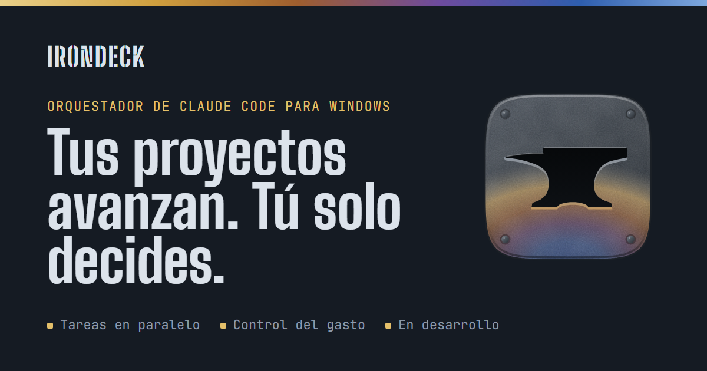

# IronDeck: orquestador de Claude Code para Windows

**Tus proyectos avanzan. Tú solo decides.**

IronDeck es una app de escritorio para Windows que dirige a Claude Code por ti: corre varios agentes a la vez, retoma cuando algo se corta, vigila el límite de 5 horas y el semanal de tu plan (y solo gasta más allá si tú lo permites), y solo te llama cuando necesita una decisión.

[Sitio](https://dwladimirl.github.io/irondeck/) · [Guía](docs/guia.md) · [Marca](docs/marca.md) · [Novedades](https://dwladimirl.github.io/irondeck/#novedades) · [Read in English](README.md)

> En desarrollo · Windows nativo · Proyecto independiente, no afiliado a Anthropic.

## Por qué existe

Claude Code trabaja rápido. El cuello de botella eres tú.

- **Hay que estar encima.** Lanzar una tarea, esperar, revisar y lanzar la siguiente. Si te alejas, todo se detiene.
- **El límite te corta a mitad.** Al llegar al límite de 5 horas o al de la semana, la tarea queda a medias y nadie la retoma.
- **Varias a la vez es un caos.** Varias sesiones en el mismo proyecto se pisan, y pierdes la cuenta de tu plan.

IronDeck se encarga de esa parte. Tú decides qué se construye y apruebas lo terminado.

## Cómo funciona

1. **Describes el trabajo por pasos:** investigar, diseñar, construir, revisar. Cada paso usa el modelo de Claude que le conviene.
2. **IronDeck lo pone en marcha:** Claude Code en tu PC, cada tarea en su propia copia del proyecto, hasta cuatro a la vez.
3. **Te pregunta solo lo necesario:** las decisiones esperan en una bandeja, con aviso de Windows.
4. **Apruebas lo terminado:** los cambios entran a tu proyecto solo con tu visto bueno.
5. **Lo que funciona se queda:** tus skills, con todas sus versiones.

## Funciones

| Dirige tus agentes | Controla el gasto | Afina tus skills |
|---|---|---|
| Hasta 4 tareas en paralelo, cada una aislada en su propia copia del repo | Límite de 5 horas y semanal, con las cifras de claude.ai | Biblioteca con versiones para paquetes `.skill`; el número nunca baja |
| Flujos por pasos con modelo, esfuerzo y permisos por paso; los pasos corren en orden² | En el límite, espera el reinicio, o sigue con uso extra si lo elegiste¹ | Comparaciones A/B: 3 corridas por caso y versión, con Opus como juez |
| Tras un corte o un apagado, repite el paso que quedó a medias; reintenta un fallo con un modelo más fuerte, si lo hay | Tope semanal: pregunta antes de pasarlo | Revisa las skills con el validador oficial y las exporta como `.skill` o plugin |
| Bandeja de decisiones con avisos de Windows | Tú eliges: solo tu plan, o tu plan más uso extra hasta tu tope¹ | |

Y además: instalador para Windows, y actualizaciones que vuelven solas a la versión anterior si la nueva no arranca.

¹ El modo con uso extra llega antes del lanzamiento. Hoy IronDeck funciona en «solo plan» y corta la tarea en cuanto Claude Code informa un cobro aparte.
² Que cada paso reciba lo que entregó el anterior llega en la fase actual.

## Bajo el capó

Versión en desarrollo; los detalles pueden cambiar antes del lanzamiento.

- **Invocación:** el Claude Code oficial en modo sin pantalla (`claude -p`), con la tarea por la entrada estándar y la salida `stream-json` leída en vivo. Probado con Claude Code 2.1.287.
- **Aislamiento:** cada tarea en su propia copia del repositorio; IronDeck hace los commits y solo fusiona con tu aprobación. Una fusión que no entra limpia queda registrada y se reintenta desde la bandeja.
- **Permisos:** reglas exactas de herramientas permitidas por paso, como `Bash(npm test)`.
- **Límites del plan:** los lee de los avisos de límite que emite Claude Code (porcentaje usado y hora de reinicio); un límite pausa la tarea y no cuenta como fallo.
- **Cobro:** comprueba con qué cuenta corre Claude Code; no usa claves de API. El modo «solo plan» corta una tarea si Claude Code informa uso extra; el modo «plan + uso extra» lo permite hasta un tope en dinero (antes del lanzamiento).
- **Fallos:** falla una tarea que termina con error o con la entrega a medias. Un reintento con un modelo mayor, si lo hay, y después decides tú; un permiso negado la detiene sin reintentar. Máximo de 6 horas por tarea.
- **Interfaz:** un servidor que corre solo en tu PC y rechaza peticiones de otras páginas web; la ventana se abre en tu navegador.
- **Pila:** Node.js y TypeScript, estado en JSON y Git para las versiones.
- **Pruebas:** 1160 pruebas automáticas, la mayoría contra un Claude Code simulado; desde octubre, también pasadas reales en Windows con el de verdad.
- **Todavía no:** pasar el resultado de un paso al siguiente, el modo con uso extra y la capa autónoma.

## Avance

- **3 de 6** fases terminadas · **1160** pruebas automáticas, más pasadas reales en Windows · **7 oct 2026:** primera instalación real en Windows · **28 s:** lo que tardó en volver solo a la versión anterior tras una actualización fallida

| Fase | Qué | Estado |
|---|---|---|
| 0 · Base | El esqueleto común y una primera tarea completa, de punta a punta | Terminada |
| 1 · Funciones principales | Versiones, plantillas, ventana, motor de tareas, control del plan y verificación de skills | Terminada |
| 2 · Conexión con Claude Code real | Flujos, comparaciones, exportación e instalador para Windows, todo conectado | Terminada |
| 3 · Uso real en Windows | Actualizaciones, pasar resultados entre pasos, cuánto de tu semana gastó IronDeck y el respaldo de la biblioteca en tu GitHub | **En curso** |
| 4 · Autonomía | Un chat central que reparte el trabajo, revisión automática y conexión con otros agentes | Siguiente |
| 5 · Lanzamiento | La edición base, los kits y la versión para equipos | Después |

Las novedades están en el [sitio](https://dwladimirl.github.io/irondeck/#novedades).

## Ediciones

Precios y fechas por anunciar. No se cobra nada por adelantado; la lista de espera se entera primero.

- **IronDeck:** para una persona en su PC, con su propio Claude Code y su plan de Claude.
- **IronDeck Team:** para equipos y empresas con trabajos grandes y muchos agentes a la vez. En diseño.
- **Kits:** plantillas, flujos, skills y documentos de contexto, empezando por el método con que se construye IronDeck. En preparación.

## Apoya el proyecto

Los enlaces de la lista de espera, Ko-fi y GitHub Sponsors están en el [sitio](https://dwladimirl.github.io/irondeck/#apoya). Un aporte no es una compra: no da acceso ni fija fechas. También ayuda dejar una estrella en este repositorio, seguirlo con **Watch** y compartirlo.

## Preguntas

**¿Qué necesito?** Una PC con Windows, Claude Code instalado con tu cuenta y un plan de Claude que lo incluya: Pro o Max, o un plan Team o Enterprise. Además, Git y Node.js. Lista provisional.

**¿Qué cuenta usa?** La tuya. IronDeck lanza tu propia instalación de Claude Code en tu PC. No te pide iniciar sesión, no guarda tu contraseña y no pasa tu sesión por ningún servidor.

**¿Puede gastar más allá de mi plan?** Solo si tienes activado el uso extra en tu cuenta de Anthropic; sin él, no puede. Si lo tienes activado, por defecto IronDeck detiene la tarea en cuanto Claude Code informa uso extra, y lo consumido hasta ese aviso se cobra. Podrás permitir el uso extra de tu cuenta hasta un tope en dinero; ese modo llega antes del lanzamiento.

**¿Puede romper algo en mi PC?** Cada tarea trabaja en una copia de tu proyecto y solo puede usar las herramientas que permite su paso. Sus cambios entran a tu proyecto cuando los apruebas, pero los comandos que permitas, como publicar o instalar paquetes, actúan fuera de esa copia. Es una versión en desarrollo: úsala con Git y copias de seguridad.

**¿Qué sale de mi PC?** IronDeck no tiene un servidor en internet: su servidor corre solo en tu PC. Sale lo que Claude Code envía a Anthropic al trabajar, las consultas a GitHub para buscar actualizaciones, lo que hagan tus tareas con los permisos que les des y, cuando llegue esa función, el respaldo de tu biblioteca en tu propia cuenta de GitHub. Nada de eso pasa por mí.

**¿El código es abierto?** Por ahora es privado. Este repositorio es la vitrina pública del proyecto.

**¿Mac o Linux?** Por ahora, solo Windows.

## Sobre este repositorio

| Ruta | Qué es |
|---|---|
| `index.html`, `en/index.html` | El sitio en español y en inglés, servido por GitHub Pages. Se generan: no se editan a mano |
| `fuente/` | La fuente de la página (los dos idiomas), sus estilos, la plantilla de la imagen para redes y los textos legales (`fuente/legal/`) |
| `privacidad.html`, `terminos.html`, `terminos-beta.html` y sus versiones en `en/` | Aviso de privacidad, términos del sitio y términos de la beta. Se generan. Mientras falte en `sitio.json` el titular, el correo o la fecha de vigencia, salen como borrador y la lista de espera, las aportaciones y la analítica quedan apagadas |
| `sitio.json` | Enlaces (lista de espera, Ko-fi, Sponsors, video, canal), datos legales (titular, correo de contacto y fecha de vigencia), títulos y descripciones para buscadores, código de Search Console y token opcional de Cloudflare Web Analytics |
| `novedades.json` | Las novedades que muestra el sitio, la más reciente primero |
| `herramientas/armar.py` | Arma el sitio con los archivos de arriba (Python 3, sin dependencias) |
| `herramientas/marca.py` | Genera los SVG del logo en `marca/` (Python 3, sin dependencias) |
| `docs/` | Las guías, en español e inglés |
| `fuentes/` | Las tipografías, alojadas aquí con licencia SIL Open Font License |
| `marca/` | El logo: SVG (detallado, simple, una tinta, horizontal), PNG de 16 a 512 px, avatar e icono de Windows (`irondeck.ico`). Uso en [docs/marca.md](docs/marca.md) |
| `favicon.ico`, `apple-touch-icon.png` | El icono de la pestaña del navegador y el del iPhone o iPad |

Para publicar una novedad o cambiar un enlace: edita `novedades.json` o `sitio.json`, corre `python herramientas/armar.py` y haz commit. Las imágenes para redes (`og-es.png`, `og-en.png`) salen de `fuente/og.html`, capturada a 1200×630 en un navegador.

---

IronDeck es un proyecto independiente y no está afiliado a Anthropic. Claude y Claude Code son marcas de Anthropic, PBC.

© 2026 Wladimir Diaz. Todos los derechos reservados.
