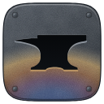
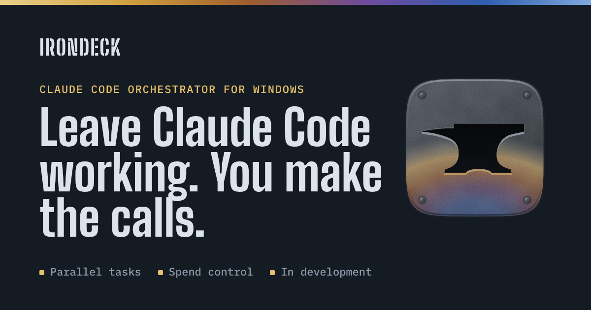

# IronDeck: Claude Code orchestrator for Windows

**Leave Claude Code working. You make the calls.**

IronDeck is a Windows desktop app that drives Claude Code for you: it runs several agents in parallel, picks up after interruptions, watches your plan's 5-hour and weekly limits (and only spends beyond them if you allow it), and only calls you in when it needs a decision.

[Website](https://dwladimirl.github.io/irondeck/en/) · [Guide](docs/guide.md) · [Brand](docs/brand.md) · [Updates](https://dwladimirl.github.io/irondeck/en/#novedades) · [Leer en español](README.es.md)

> In development · Native Windows · Independent project, not affiliated with Anthropic.

## Why it exists

Claude Code works fast. You're the bottleneck.

- **You have to babysit it.** Start a task, wait, review, start the next one. Step away and everything stops.
- **Limits cut you off halfway.** Hit the 5-hour or weekly limit and the task stops, with nobody to pick it back up.
- **Running several at once gets messy.** Parallel sessions in the same project step on each other, and you lose track of your plan.

IronDeck takes care of that part. You decide what gets built and approve what's finished.

## How it works

1. **You describe the work in steps:** research, design, build, review. Each step uses the Claude model that fits it.
2. **IronDeck sets it running:** Claude Code on your PC, each task in its own copy of the project, up to four at once.
3. **It only asks what it must:** decisions wait in an inbox, with a Windows notification.
4. **You approve the finished work:** changes reach your project only with your go-ahead.
5. **What works is kept:** your skills, with every version.

## Features

| Run your agents | Control your spend | Tune your skills |
|---|---|---|
| Up to 4 parallel tasks, each isolated in its own copy of the repo | 5-hour and weekly limits, same numbers as claude.ai | Versioned library for `.skill` packages; version numbers never go down |
| Step-by-step flows with model, effort and permissions per step; steps run in order² | At the limit, waits for the reset, or keeps going on extra usage if you chose it¹ | A/B comparisons: 3 runs per case and version, Opus as the judge |
| Reruns the interrupted step after a crash or shutdown; retries a failure with a stronger model when there is one | Weekly cap: asks before going past it | Checks skills against the official validator, exports as `.skill` or plugin |
| Decision inbox with Windows notifications | You choose: plan only, or plan plus extra usage up to your cap¹ | |

Plus a Windows installer, and updates that roll back on their own if the new version doesn't start.

¹ The extra-usage mode arrives before launch. Today IronDeck runs plan-only and stops a task as soon as Claude Code reports a separate charge.
² Handing each step what the previous one delivered comes in the current phase.

## Under the hood

Development version; details may change before launch.

- **Invocation:** the official Claude Code in headless mode (`claude -p`), task on stdin, `stream-json` output read live. Tested with Claude Code 2.1.287.
- **Isolation:** each task in its own copy of the repository; IronDeck commits and only merges with your approval. A merge that doesn't apply cleanly is logged and retried from the inbox.
- **Permissions:** exact allowed-tool rules per step, such as `Bash(npm test)`.
- **Plan limits:** read from the rate-limit events Claude Code emits (percentage used and reset time); a limit pauses the task and doesn't count as a failure.
- **Billing:** checks which account Claude Code runs under; it doesn't use API keys. Plan-only mode stops a task if Claude Code reports extra usage; plan-plus-extra mode allows it up to a spending cap (before launch).
- **Failures:** a task fails when it ends with an error or a partial delivery. One retry with a larger model when there is one, then your call; a denied permission stops it without a retry. 6-hour maximum per task.
- **Interface:** a server that runs only on your PC and rejects requests from other websites; the window opens in your browser.
- **Stack:** Node.js and TypeScript, state in JSON, Git for versions.
- **Tests:** 1,160 automated tests, most against a simulated Claude Code; since October, also real runs on Windows with the actual one.
- **Not yet:** passing one step's result to the next, the extra-usage mode, and the autonomous layer.

## Progress

- **3 of 6** phases done · **1,160** automated tests, plus real runs on Windows · **Oct 7, 2026:** first real install on Windows · **28 s** to roll itself back after a failed update

| Phase | What | Status |
|---|---|---|
| 0 · Foundation | The shared skeleton and a first complete task, end to end | Done |
| 1 · Core features | Versioning, templates, window, task engine, plan control, skill verification | Done |
| 2 · Wired to the real Claude Code | Flows, comparisons, export and the Windows installer, all connected | Done |
| 3 · Real use on Windows | Updates, passing results between steps, how much of your week IronDeck used, library backup to your GitHub | **In progress** |
| 4 · Autonomy | A central chat that hands out work, automatic review, links to other agents | Next |
| 5 · Launch | The base edition, the kits and the team version | Later |

Updates live on the [website](https://dwladimirl.github.io/irondeck/en/#novedades).

## Editions

Prices and dates to be announced. Nothing is charged in advance; the waitlist hears first.

- **IronDeck:** for one person on their PC, with their own Claude Code and Claude plan.
- **IronDeck Team:** for teams and companies running large jobs with many agents at once. In design.
- **Kits:** templates, flows, skills and context documents, starting with the method IronDeck is built with. In preparation.

## Support the project

The waitlist, Ko-fi and GitHub Sponsors links are on the [website](https://dwladimirl.github.io/irondeck/en/#apoya). A contribution isn't a purchase: it doesn't buy access or set dates. You can also star this repository, follow it with **Watch**, and share it.

## FAQ

**What do I need?** A Windows PC, Claude Code installed with your account, and a Claude plan that includes it: Pro or Max, or a Team or Enterprise plan. Also Git and Node.js. Provisional list.

**Which account does it use?** Yours. IronDeck runs your own Claude Code installation on your PC. It doesn't ask you to sign in, store your password, or route your session through any server.

**Can it spend beyond my plan?** Only if extra usage is turned on in your Anthropic account; without it, it can't. If it is on, IronDeck stops a task by default as soon as Claude Code reports extra usage, and what was used up to that point is billed. You'll be able to allow your account's extra usage up to a spending cap; that mode arrives before launch.

**Can it break something on my PC?** Each task works in a copy of your project and can only use the tools its step allows. Its changes reach your project when you approve them, but commands you allow, such as publishing or installing packages, act outside that copy. It's a version in development: use it with Git and backups.

**What leaves my PC?** IronDeck has no server on the internet: its server runs only on your PC. What leaves is what Claude Code sends to Anthropic while working, checks to GitHub for updates, whatever your tasks do with the permissions you grant them and, once that feature lands, the backup of your library to your own GitHub account. None of it goes through me.

**Is the code open source?** It's private for now. This repository is the project's public showcase.

**Mac or Linux?** Windows only, for now.

## About this repository

| Path | What it is |
|---|---|
| `index.html`, `en/index.html` | The website in Spanish and English, served by GitHub Pages. Generated: don't edit by hand |
| `fuente/` | The page source (both languages), its styles, the social image template and the legal texts (`fuente/legal/`) |
| `privacidad.html`, `terminos.html`, `terminos-beta.html` and their versions in `en/` | Privacy notice, website terms and beta terms. Generated. While `sitio.json` is missing the owner, contact email or effective date, they're built as drafts and the waitlist, contributions and analytics stay off |
| `sitio.json` | Links (waitlist, Ko-fi, Sponsors, video, channel), legal details (owner, contact email and effective date), titles and descriptions for search engines, Search Console code and optional Cloudflare Web Analytics token |
| `novedades.json` | The updates shown on the website, newest first |
| `herramientas/armar.py` | Builds the website from the files above (Python 3, no dependencies) |
| `herramientas/marca.py` | Generates the logo SVGs in `marca/` (Python 3, no dependencies) |
| `docs/` | Guides in Spanish and English |
| `fuentes/` | Self-hosted fonts, under the SIL Open Font License |
| `marca/` | The logo: SVG (detailed, simple, one-color, horizontal), PNG from 16 to 512 px, avatar and Windows icon (`irondeck.ico`). Usage in [docs/brand.md](docs/brand.md) |
| `favicon.ico`, `apple-touch-icon.png` | The browser tab icon and the iPhone or iPad icon |

To post an update or change a link, edit `novedades.json` or `sitio.json`, run `python herramientas/armar.py`, and commit.

---

IronDeck is an independent project and is not affiliated with Anthropic. Claude and Claude Code are trademarks of Anthropic, PBC.

© 2026 Wladimir Diaz. All rights reserved.
