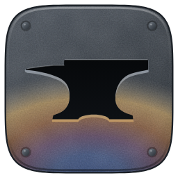

# La marca de IronDeck

El logo es una chapa de acero mate con un yunque calado. El calor del temple sube desde abajo hasta la mitad de la chapa: son los colores que toma el acero al calentarse, los mismos de la página, más apagados.

[English version](brand.md) · [Volver al inicio](../README.es.md)

## Archivos

| Archivo | Para qué |
|---|---|
| `marca/irondeck-icono.svg` | El logo detallado, para 48 px o más: textura mate, remaches y la pared del corte |
| `marca/irondeck-icono-simple.svg` | Para 32 px o menos: cabeceras, favicon, barras de herramientas |
| `marca/irondeck-horizontal.svg`, `irondeck-horizontal-clara.svg` | El logo con el nombre, para fondo claro y para fondo oscuro. El nombre va en contornos: no necesita la fuente instalada |
| `marca/irondeck-una-tinta.svg`, `irondeck-una-tinta-blanca.svg` | Una sola tinta, con el yunque como agujero real: sellos, grabado láser, bordado, documentos en blanco y negro |
| `marca/irondeck-yunque.svg` | El yunque solo |
| `marca/png/irondeck-16.png` a `irondeck-512.png` | El icono en PNG; hasta 32 px usa el dibujo simple |
| `marca/png/irondeck-avatar-800.png` | Avatar para GitHub, Ko-fi, YouTube o X: fondo oscuro y aire alrededor para el recorte redondo |
| `marca/png/irondeck-horizontal@2x.png`, `irondeck-horizontal-clara@2x.png` | El logo con el nombre, en PNG |
| `marca/irondeck.ico` | El icono del programa en Windows: 16, 24, 32, 48, 64, 128 y 256 px |
| `favicon.ico`, `apple-touch-icon.png` | La pestaña del navegador y el iPhone o iPad (en la raíz del sitio) |

## Reglas

- **El yunque es un agujero en la chapa, no una figura encima.** No lleva sombra, relieve ni brillo propio: adentro se ve oscuro y, abajo, la pared del corte.
- **Hasta 32 px, el dibujo simple; desde 48 px, el detallado.** El simple no lleva textura ni remaches y agranda el yunque para que se lea.
- **Espacio libre alrededor:** al menos un octavo del ancho del icono.
- **No** girar, estirar ni recortar la chapa, no cambiar los colores del calor y no poner el yunque sobre otra forma.
- Sobre fotos o fondos con mucho detalle, la versión en una tinta.
- El nombre va siempre como **IRONDECK**, en mayúsculas estarcidas, a la derecha del icono, con el alto de las mayúsculas cerca de la mitad del alto del icono.

## Colores

| Uso | Hex |
|---|---|
| Acero, de arriba abajo | `#525962` → `#3d434a` → `#30353b` |
| Calor, de lo más caliente a lo más frío | `#405584` azul · `#6c5570` púrpura · `#946748` bronce · `#bf9c64` paja |
| Tinta (texto y una tinta sobre claro) | `#121820` |
| Claro (texto sobre oscuro) | `#e4e9ef` |

## Tipografía

El nombre: Big Shoulders Stencil Display, peso 800, espaciado 0,04 em. Los textos de la página: Inter Tight e IBM Plex Mono. Están en `fuentes/`, con licencia SIL Open Font License.

## El yunque

Un yunque inglés: cuerno cónico cuya cara de abajo baja en una sola curva hasta el cuerpo, mesa más baja que la cara, cara de acero, talón, cintura estrecha y patas con arco. El alto es el 46 % del largo.

## Cambiar o regenerar

- Los SVG salen de `herramientas/marca.py` (Python 3, sin dependencias): `python herramientas/marca.py`. Ahí están el dibujo del yunque, los colores y las posiciones.
- Los PNG y los ICO se exportan de esos SVG con cualquier navegador o con Inkscape. El ICO lleva 16, 24 y 32 px del dibujo simple y 48, 64, 128 y 256 px del detallado.
- Las imágenes para redes (`og-es.png`, `og-en.png`) salen de `fuente/og.html`, que ya usa el icono.

---

IronDeck es un proyecto independiente y no está afiliado a Anthropic. Claude y Claude Code son marcas de Anthropic, PBC.
